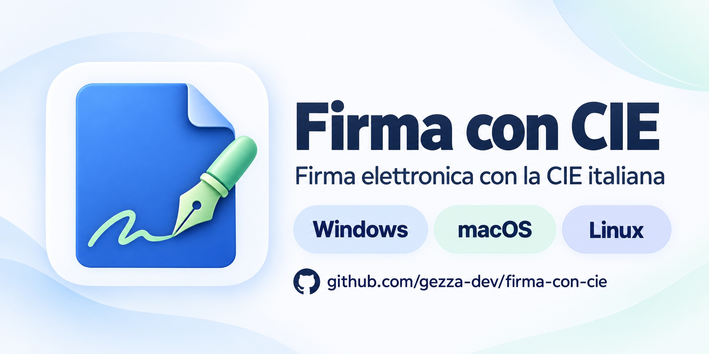
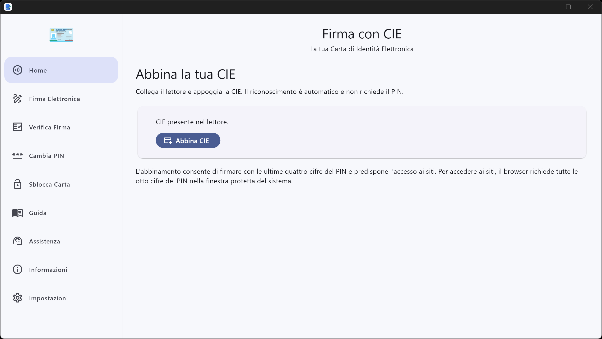
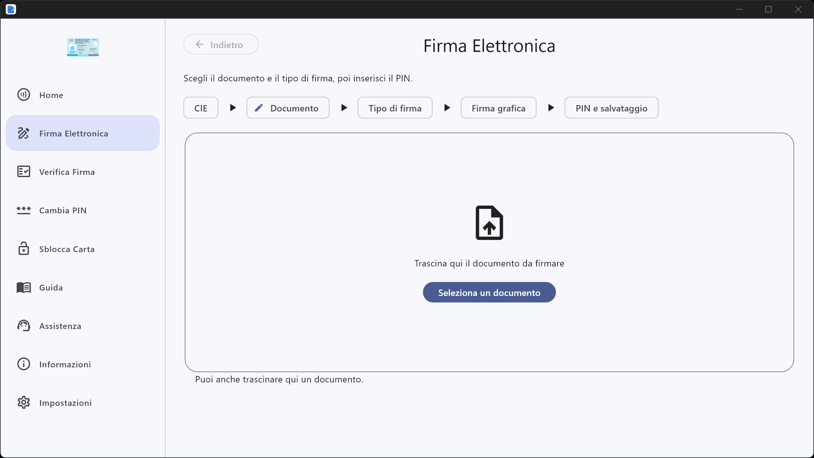
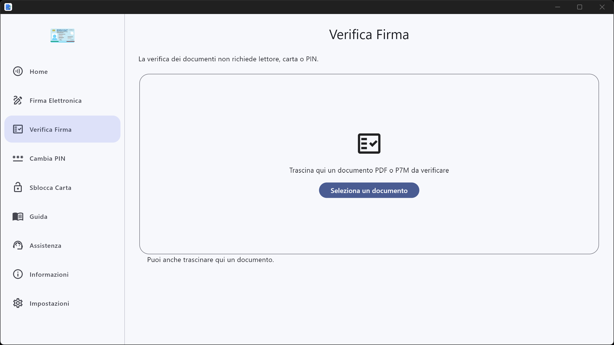
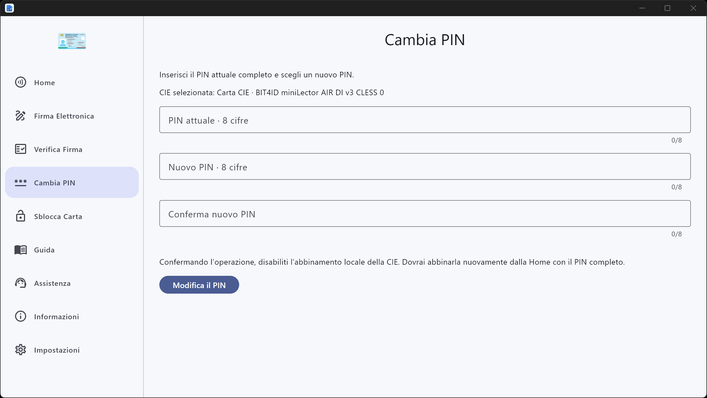
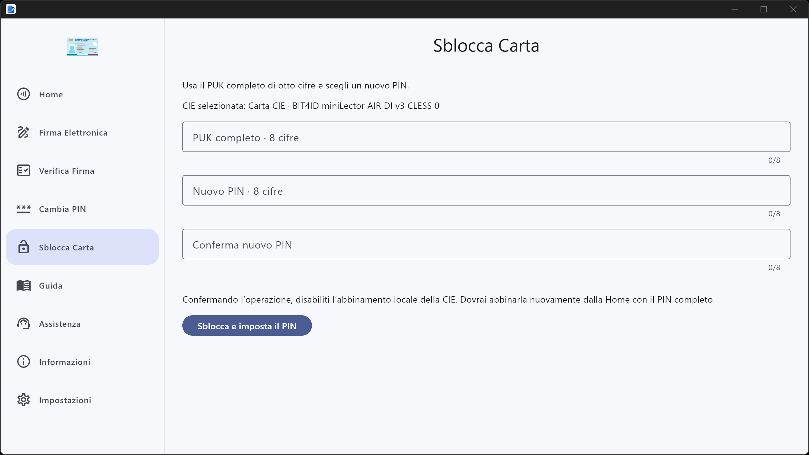
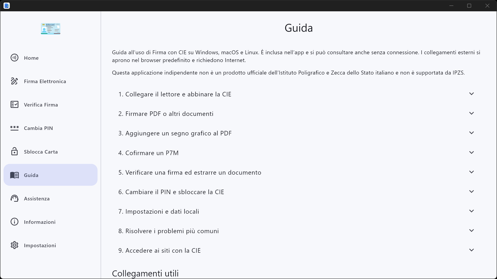

<p align="center"></p>

# Firma con CIE

Applicazione desktop indipendente per la firma elettronica tramite **Carta d’Identità Elettronica italiana (CIE)**, disponibile per **Windows, macOS e Linux**, con interfaccia in italiano e inglese.

**Questo non è un prodotto ufficiale dell’Istituto Poligrafico e Zecca dello Stato italiano e non è supportato da IPZS.**

## Download

Apri la pagina dell’**[ultima release stabile](https://github.com/gezza-dev/firma-con-cie/releases/latest)** e scegli il pacchetto adatto al tuo computer. Ogni release comprende istruzioni, checksum SHA-256 e materiali sorgente.

| Sistema | Architettura | Pacchetto |
| --- | --- | --- |
| macOS 12 o successivo | Apple Silicon e Intel | DMG Universal |
| Windows 10 o successivo | x64 | Installer `.exe` x64 |
| Windows 11 | ARM64 | Installer `.exe` ARM64 |
| Linux | x86_64 | AppImage, `.deb`, `.rpm`, `.pkg.tar.zst` |
| Linux | ARM64 / AArch64 | AppImage e `.deb` |

I requisiti Linux dipendono dal formato: l’AppImage usa una base Ubuntu 22.04 con glibc 2.35; i pacchetti nativi hanno requisiti propri. Consulta le [istruzioni AppImage](docs/LINUX_APPIMAGE.md), i [pacchetti nativi](docs/LINUX_DISTRIBUTION_PACKAGES.md) e il [supporto ARM64](docs/LINUX_ARM64.md). La compatibilità e le prove effettivamente eseguite sono documentate in [Stato e verifiche](docs/STATUS.md).

[Elenco di tutte le release](https://github.com/gezza-dev/firma-con-cie/releases) · [Note della prima release](docs/releases/v1.0.0.md)

## Funzionalità

- **Gestione delle CIE:** rilevamento automatico di lettore e carta, abbinamento di più CIE, intestatario e numero della carta, indicazione della presenza nel lettore.
- **Firma Elettronica:** procedura guidata per firmare PDF in formato PAdES e documenti in formato CAdES/P7M, con CIE abbinata o non presente in elenco; cofirma dei P7M.
- **Firma grafica PDF:** anteprima, scelta di pagina e posizione, immagine personale oppure firma testuale con nome e cognome letti dalla CIE e data e ora con fuso locale.
- **Verifica Firma:** controllo di PDF e P7M anche senza lettore, con risultati distinti per integrità, certificati, fiducia, revoca, marche temporali e validità storica; estrazione del documento dai P7M.
- **Accesso ai siti con CIE:** preparazione durante l’abbinamento e controllo dei browser supportati; l’accesso si esegue dal browser e non richiede di lasciare aperta l’interfaccia dell’app.
- **Cambio PIN e Sblocco Carta:** pagine dedicate per modificare il PIN o sbloccare la CIE tramite PUK, senza ripetere automaticamente tentativi falliti.
- **Guida e Assistenza:** guida inclusa, consultabile anche senza connessione, collegamenti e contatti ufficiali per la CIE.
- **Impostazioni:** lingua, tema chiaro/scuro o di sistema, proxy HTTP/HTTPS e diagnostica facoltativa.

L’abbinamento permette di firmare usando le ultime quattro cifre del PIN. **Per accedere ai siti si usano tutte le otto cifre**, inserite nella finestra protetta del sistema o del componente del browser.

Le verifiche distinguono sempre le prove disponibili da quelle mancanti: quando le informazioni non bastano, il risultato rimane **indeterminato**. Il progetto non attesta la qualificazione giuridica di una firma e non sincronizza le Trusted List europee.

## Screenshots

Le schermate seguenti mostrano la versione Windows di Firma con CIE. Fai clic su un’immagine per visualizzarla a dimensione intera.

### Home

Riconoscimento automatico della carta e primo abbinamento, che prepara la firma con PIN parziale e l’accesso ai siti.



### Firma Elettronica

Procedura guidata per selezionare il documento, scegliere il tipo di firma e completare la firma con la CIE.



### Verifica Firma

Selezione o trascinamento di un documento PDF o P7M da verificare, senza lettore, carta o PIN.



### Cambia PIN

Modifica del PIN della CIE, con inserimento del PIN attuale e conferma del nuovo codice.



### Sblocca Carta

Sblocco della CIE tramite PUK e impostazione di un nuovo PIN.



### Guida

Guida inclusa nell’app, consultabile anche senza connessione, con istruzioni per le principali funzionalità.



## Installazione

### macOS

1. Scarica e apri il DMG Universal.
2. Trascina **Firma con CIE** nella cartella **Applicazioni** e avvia la copia installata.
3. Se l’app indica che il componente per l’accesso ai siti deve essere attivato, segui la procedura guidata. L’abbinamento esistente viene conservato.

Il pacchetto della release macOS è firmato **Developer ID Application**. L’esito della notarizzazione Apple è riportato nelle note e nel manifest del pacchetto.

### Windows

1. Scarica l’installer x64 oppure ARM64, in base all’architettura del computer.
2. Avvia l’installer e conferma la richiesta amministrativa di Windows.
3. Il pacchetto installa l’app, i prerequisiti inclusi e il componente per l’accesso ai siti.

Lo stato della firma Authenticode del pacchetto è indicato nelle note della release. [Installazione e aggiornamento Windows](docs/WINDOWS_INSTALLER.md).

### Linux

Scegli il pacchetto nativo della distribuzione oppure l’AppImage della tua architettura. Per usare l’AppImage, abilita l’esecuzione del file nelle sue proprietà e avvialo. PC/SC e un driver compatibile con il lettore devono essere disponibili nel sistema.

Per l’accesso ai siti, segui le indicazioni dell’app relative al browser. Le autorizzazioni aggiuntive di Firefox Snap vengono richieste soltanto quando necessarie. [AppImage](docs/LINUX_APPIMAGE.md) · [Pacchetti nativi](docs/LINUX_DISTRIBUTION_PACKAGES.md) · [Browser Linux](docs/LINUX_FIREFOX.md).

## Primo utilizzo

Per abbinamento, firma e accesso ai siti servono una CIE, il suo PIN e un lettore contactless compatibile. La sola verifica di documenti non richiede carta o lettore.

1. Collega il lettore, appoggia la CIE e attendi il riconoscimento automatico.
2. Nella **Home** premi **Abbina CIE** e inserisci il PIN completo nell’app. La procedura prepara anche l’accesso ai siti; eventuali interventi richiesti dal sistema vengono indicati separatamente.
3. Per firmare, apri **Firma Elettronica** e segui i passaggi della procedura guidata. Il PIN va inserito soltanto nel campo protetto dell’app.
4. Per verificare, apri **Verifica Firma** e seleziona o trascina il documento.
5. Per accedere a un sito, apri il browser e scegli l’accesso tramite CIE con lettore. Inserisci il PIN completo quando richiesto dal sistema o dal componente del browser.

Le carte abbinate a **CIE ID Universal** appartengono a un archivio diverso e vanno abbinate nuovamente a Firma con CIE. [Browser collaudati](docs/WEB_AUTHENTICATION.md#browser-collaudati) · [Guida alle verifiche](docs/STATUS.md).

## Compilazione dai sorgenti

La GUI è Flutter/Dart; middleware e SDK sono C/C++, con integrazioni dei sistemi operativi. Le versioni degli strumenti e delle dipendenze sono fissate nei lockfile.

```sh
git clone https://github.com/gezza-dev/firma-con-cie.git
cd firma-con-cie
flutter pub get --enforce-lockfile
flutter analyze --no-pub
flutter test --no-pub
```

La compilazione completa richiede anche backend nativo, anteprima PDF, componenti Web e runtime DSS/JVM privati. Il solo comando `flutter build` non genera questi elementi. Consulta **[Compilazione](docs/BUILDING.md)** per prerequisiti e comandi di ciascuna piattaforma.

Percorsi e impostazioni personali si conservano in `local-build.json` e `LOCAL_SETUP.md`, esclusi da Git. Le chiavi di firma non appartengono al repository.

## Licenze e provenienza

Il progetto deriva dal lavoro di [CIE ID Universal](https://github.com/gezza-dev/cie-id-macos-universal) e dal middleware originale [italia/cie-middleware-macos](https://github.com/italia/cie-middleware-macos), conservandone provenienza e attribuzioni.

La licenza principale è **BSD-3-Clause**, ma il prodotto include componenti con licenze diverse: non tutto il repository né il pacchetto completo sono esclusivamente BSD. Le release affiancano ai binari i materiali sorgente e gli avvisi previsti per le dipendenze distribuite.

[LICENSE](LICENSE) · [NOTICE.md](NOTICE.md) · [Matrice delle licenze](docs/LICENSING.md) · [Materiali della release](docs/RELEASE.md)

## Assistenza e segnalazioni

- [Guida ufficiale al software CIE](https://www.cartaidentita.interno.gov.it/info-utili/software-cie-2/)
- [Domande frequenti ufficiali](https://www.cartaidentita.interno.gov.it/Assistenza/#FAQ)
- [Segnalazioni relative a Firma con CIE](https://github.com/gezza-dev/firma-con-cie/issues)

Non inserire PIN, PUK, documenti personali, certificati della propria CIE o credenziali nelle segnalazioni. I canali ufficiali assistono la CIE e i prodotti ufficiali; le segnalazioni di questa applicazione indipendente vanno aperte nel repository del progetto.
